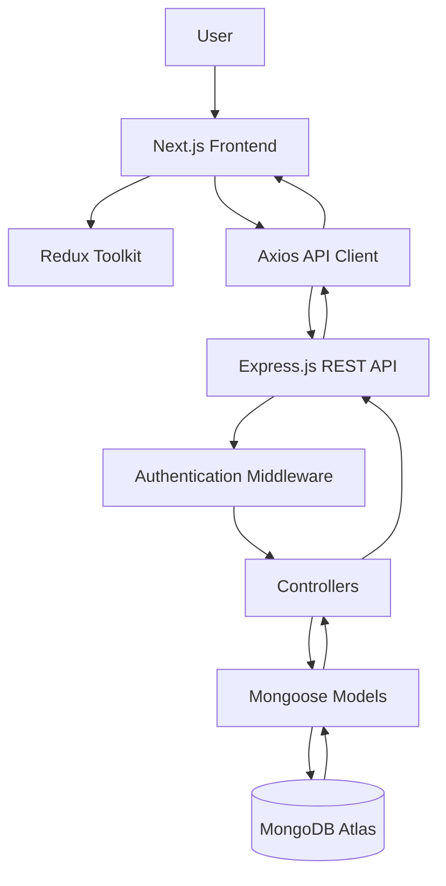
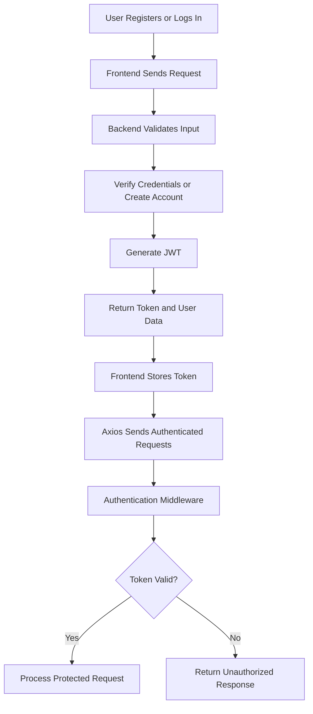

# Task Management System

A full-stack Task Management System built using **Next.js, Node.js, Express.js, MongoDB, and Redux Toolkit**. The application allows users to securely authenticate, manage their tasks, track task priorities and statuses, and manage their profiles through a responsive web interface.

This project was developed as part of a technical assignment for **AGM Global Solutions**, demonstrating full-stack development, REST API integration, authentication, authorization, and database management.

## 🚀 Live Demo

- **Frontend:** https://task-management-system-eight-ruby.vercel.app
- **Backend API:** https://task-management-system-backend-ov69.onrender.com
- **GitHub Repository:** https://github.com/Brijesh-Sharma2004/Task-Management-System

## ✨ Features

- **User Authentication:** Secure registration and login functionality.
- **JWT Authentication:** Token-based authentication for protected API endpoints.
- **Password Security:** Password hashing using bcrypt.
- **Task Management:** Create, view, update, and delete tasks.
- **Task Priorities:** Organize tasks according to their priority.
- **Task Status Tracking:** Manage task progress through status updates.
- **User Profile:** Access authenticated user profile information.
- **Role-Based Authorization:** Support for admin and regular-user permissions.
- **State Management:** Redux Toolkit for managing authentication state.
- **REST API Integration:** Axios for communication between the frontend and backend.
- **Database Integration:** MongoDB Atlas with Mongoose for data persistence.
- **Responsive Interface:** A web interface built with Next.js and React.

## 🛠️ Tech Stack

| Technology | Purpose |
|---|---|
| Next.js | Frontend framework |
| React.js | Component-based user interface |
| Redux Toolkit | Application state management |
| Axios | HTTP requests to backend APIs |
| Node.js | Backend JavaScript runtime |
| Express.js | REST API development |
| MongoDB Atlas | Cloud database |
| Mongoose | MongoDB object modeling |
| JWT | Authentication and token verification |
| bcrypt | Password hashing |
| Vercel | Frontend deployment |
| Render | Backend deployment |

## 📁 Project Structure

```text
Task-Management-System/
├── backend/
│   ├── config/
│   │   └── db.js
│   ├── controllers/
│   │   ├── authController.js
│   │   ├── taskController.js
│   │   └── userController.js
│   ├── middleware/
│   │   ├── authMiddleware.js
│   │   ├── errorMiddleware.js
│   │   └── roleMiddleware.js
│   ├── models/
│   │   ├── Task.js
│   │   └── User.js
│   ├── routes/
│   │   ├── authRoutes.js
│   │   ├── taskRoutes.js
│   │   └── userRoutes.js
│   ├── server.js
│   ├── package.json
│   └── .env
│
├── frontend/
│   ├── app/
│   │   ├── login/
│   │   ├── register/
│   │   ├── tasks/
│   │   └── profile/
│   ├── components/
│   ├── lib/
│   │   ├── api/
│   │   ├── store/
│   │   └── authSlice
│   ├── package.json
│   └── .env.local
│
└── README.md
```

*Note: The structure above highlights the main project files and directories; some supporting files and nested directories have been omitted for readability.*

## 🏗️ Application Architecture

The application follows a frontend-backend architecture in which the Next.js frontend communicates with the Express.js backend through REST APIs.



### How It Works

1. The user interacts with the Next.js frontend.
2. Redux Toolkit manages the application's authentication state.
3. Axios sends HTTP requests to the Express.js backend.
4. Authentication middleware verifies JWT tokens for protected routes.
5. Controllers execute business logic and interact with Mongoose models.
6. MongoDB stores and retrieves user and task information.
7. The backend returns JSON responses to the frontend.
8. The frontend updates the interface based on the API response.

## 🔐 Authentication Flow



- Passwords are hashed before being stored in the database.
- JWT tokens are used to authenticate subsequent requests.
- Protected routes require valid authentication.
- Role-based middleware restricts access to authorized roles.
- The frontend uses an authentication initializer to restore the user's session when a token is available.

## ⚙️ Installation and Setup

### Prerequisites

Make sure you have the following installed:

- Node.js and npm
- Git
- A MongoDB Atlas account or another supported MongoDB instance

### 1. Clone the Repository

```bash
git clone https://github.com/Brijesh-Sharma2004/Task-Management-System.git
cd Task-Management-System
```

### 2. Configure the Backend

```bash
cd backend
npm install
```

Create a `.env` file inside the `backend` directory and configure the required variables:

```env
PORT=5000
MONGO_URI=your_mongodb_connection_string
JWT_SECRET=your_secure_jwt_secret
```

Use the exact environment variable names expected by your backend code. Never commit real database credentials or JWT secrets to GitHub.

### 3. Start the Backend

```bash
npm start
```

If your `package.json` does not define a start script, run:

```bash
node server.js
```

The backend should run at:

`http://localhost:5000`

### 4. Configure the Frontend

Open a new terminal:

```bash
cd frontend
npm install
```

Create a `.env.local` file inside the `frontend` directory:

```env
NEXT_PUBLIC_API_URL=http://localhost:5000/api
```

Ensure the variable name matches the one used in your Axios configuration.

### 5. Start the Frontend

```bash
npm run dev
```

Open the application at:

`http://localhost:3000`

## 🔗 API Integration

The frontend uses Axios to communicate with the backend API.

The API client centralizes HTTP requests and can attach the JWT token to requests that require authentication.

The backend organizes endpoints using Express routers, controllers, and middleware.

| Component | Responsibility |
|---|---|
| Routes | Define API endpoints |
| Controllers | Handle request logic and responses |
| Middleware | Handle authentication, authorization, and errors |
| Models | Define MongoDB document structures |
| Database configuration | Establish the MongoDB connection |

The exact endpoints and request payloads depend on the backend implementation.

## 🌐 Deployment

The project is deployed using separate frontend and backend services.

- **Frontend:** Hosted on Vercel.
- **Backend:** Hosted on Render.
- **Database:** MongoDB Atlas.

### Deployment Configuration

1. Deploy the backend and configure its environment variables on Render.
2. Configure MongoDB Atlas network access and database credentials.
3. Set the frontend API URL to the deployed backend endpoint.
4. Configure the backend CORS policy to allow the deployed frontend origin.
5. Deploy the frontend to Vercel.
6. Test authentication and task operations against the deployed application.

**Important:** Never expose private environment variables in frontend code or commit secret credentials to the repository.

## 🔮 Future Improvements

- Add task search, filtering, and sorting.
- Implement task deadlines and reminders.
- Add pagination for large task lists.
- Improve validation and automated testing.
- Add detailed task activity tracking.
- Enhance accessibility and mobile responsiveness.
- Introduce more comprehensive analytics and reporting.

## 👨‍💻 Author

**Brijesh Sharma**

B.Tech Computer Science and Engineering student interested in full-stack web development, problem-solving, and building practical software applications.

- **GitHub:** [Brijesh-Sharma2004](https://github.com/Brijesh-Sharma2004)

---

⭐ If you find this project useful, consider giving the repository a star.

